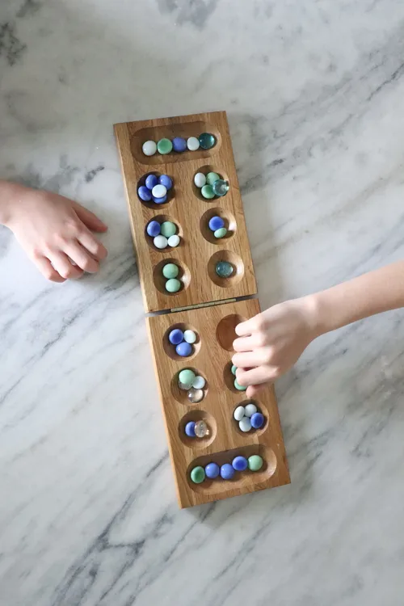

# Mancala

Simple implementation of [Mancala](https://en.wikipedia.org/wiki/Mancala).

## Build and run

```
mvn package
java -jar target/mancala.jar
```

## API

Swagger UI at http://localhost:8080/openapi-ui/index.html

```
curl -X POST http://localhost:8080/games
curl -X GET http://localhost:8080/games/1
curl -X PUT http://localhost:8080/games/1/pits/1

curl http://localhost:8080/health
curl http://localhost:8080/metrics
```
